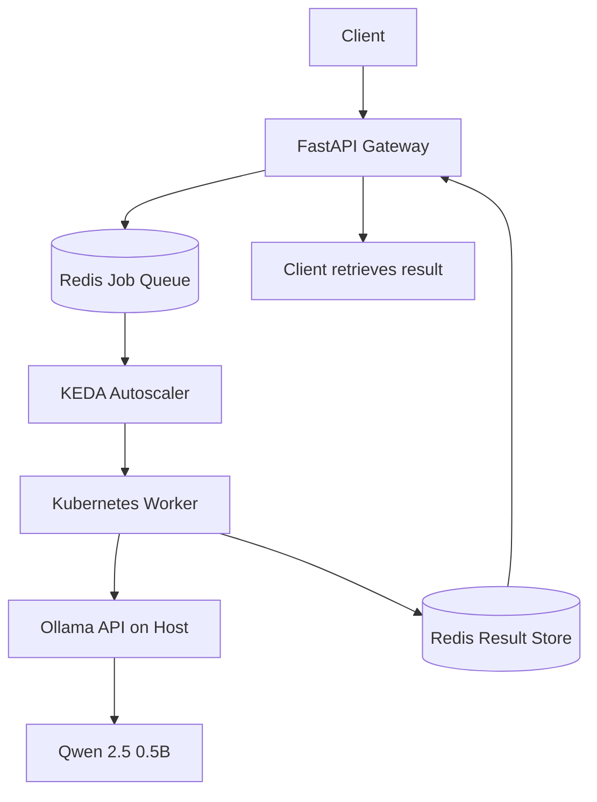

# Scale-to-Zero LLM Inference on Kubernetes

A queue-based LLM inference system that uses **FastAPI, Redis, Kubernetes, and KEDA** to process inference requests asynchronously and scale worker pods down to zero when there is no work.

The local demo runs Qwen 2.5 0.5B through Ollama on the host machine, while a Kubernetes worker consumes queued jobs and stores generated responses in Redis.

## Features

- **Asynchronous inference API:** Submit prompts and receive a job ID without waiting for inference.
- **Redis-backed job queue:** Buffer requests until a worker is available.
- **Event-driven autoscaling:** KEDA monitors Redis queue activity and scales Kubernetes workers from zero when jobs arrive.
- **Scale-to-zero:** Worker pods return to zero replicas after the queue becomes inactive.
- **Real LLM inference:** Generate responses using Qwen 2.5 0.5B through Ollama.
- **Result polling:** Retrieve completed responses using the job ID.
- **Local development:** Run the system using Docker Desktop, k3d, and Kubernetes without paying for cloud GPU resources.

## Architecture



### Request lifecycle

1. A client submits a prompt to `POST /generate`.
2. The gateway places the job in the Redis queue and returns a job ID.
3. KEDA detects queue activity and activates the worker deployment.
4. The worker consumes the job and sends the prompt to the Ollama API.
5. Ollama generates a response using Qwen 2.5 0.5B.
6. The worker stores the result in Redis.
7. The client polls `GET /result/{job_id}` to retrieve the response.
8. When the queue becomes inactive, KEDA scales the worker deployment back to zero.

## Tech Stack

| Component | Technology | Purpose |
|---|---|---|
| API gateway | FastAPI | Request ingestion and job IDs |
| Queue and result store | Redis | Job buffering and result retrieval |
| Containerization | Docker | Build gateway and worker images |
| Local Kubernetes | k3d | Run Kubernetes locally |
| Autoscaling | KEDA | Scale workers based on Redis queue activity |
| Inference runtime | Ollama | Serve the local language model |
| LLM | Qwen 2.5 0.5B | Generate responses |
| Client tools | PowerShell, `kubectl` | Submit requests and inspect system state |

## Prerequisites

- Windows with Docker Desktop configured for Linux containers
- kubectl
- k3d
- Helm
- Ollama installed on the host
- The `qwen2.5:0.5b` model downloaded in Ollama

The commands below assume the repository's local cluster and Kubernetes resources have already been configured.

## Run the Demo

### 1. Start Ollama

Ensure Ollama is running and the model is available:

```powershell
ollama run qwen2.5:0.5b
```

The worker connects to Ollama using:

```text
http://host.docker.internal:11434
```

### 2. Check Kubernetes resources

```powershell
kubectl get nodes
kubectl get pods -n llm-gateway
kubectl get scaledobject -n llm-gateway
kubectl get deployment worker -n llm-gateway
```

### 3. Forward the gateway port

Run this command in a dedicated terminal and leave it running:

```powershell
kubectl port-forward -n llm-gateway service/gateway 8001:80
```

If port 8001 is already in use, reuse the existing port-forward or choose another local port.

### 4. Check gateway health

```powershell
Invoke-RestMethod "http://localhost:8001/health"
```

Expected response:

```json
{
  "status": "ok"
}
```

### 5. Submit an inference request

```powershell
$body = @{
    prompt = "Explain Kubernetes autoscaling in simple words."
} | ConvertTo-Json

$response = Invoke-RestMethod `
    -Uri "http://localhost:8001/generate" `
    -Method Post `
    -ContentType "application/json" `
    -Body $body

$response
```

The response contains a job ID.

### 6. Retrieve the result

```powershell
$id = $response.job_id

Invoke-RestMethod "http://localhost:8001/result/$id"
```

A result may initially be `pending` while the worker processes the job. Poll the endpoint again until it returns `done` or an error.

### 7. Observe autoscaling

```powershell
kubectl get deployment worker -n llm-gateway
kubectl get pods -n llm-gateway
kubectl get scaledobject worker-autoscaler -n llm-gateway
kubectl get hpa -n llm-gateway
```

After the queue becomes inactive and the cooldown period elapses, the worker should return to zero replicas.

## API Reference

| Method | Endpoint | Description |
|---|---|---|
| `GET` | `/health` | Check gateway health |
| `POST` | `/generate` | Enqueue a prompt and return a job ID |
| `GET` | `/result/{job_id}` | Retrieve the job status and result |

Example request body:

```json
{
  "prompt": "What is a message queue?"
}
```

## Configuration

The local worker uses these environment variables:

| Variable | Local value | Purpose |
|---|---|---|
| `REDIS_HOST` | `redis` | Redis service hostname |
| `REDIS_PORT` | `6379` | Redis service port |
| `OLLAMA_URL` | `http://host.docker.internal:11434` | Host Ollama API |
| `MODEL_ID` | `qwen2.5:0.5b` | Model used for inference |

The KEDA `ScaledObject` monitors the `inference_queue` Redis list. The current local configuration has a minimum of zero worker replicas and a maximum of two.

## Current Implementation and Limitations

- The local Kubernetes worker autoscaling and scale-to-zero behavior have been tested.
- Real inference through Ollama and Qwen 2.5 0.5B has been tested.
- The model runs through Ollama on the host; it is not currently running inside a Kubernetes GPU inference pod.
- The current verified